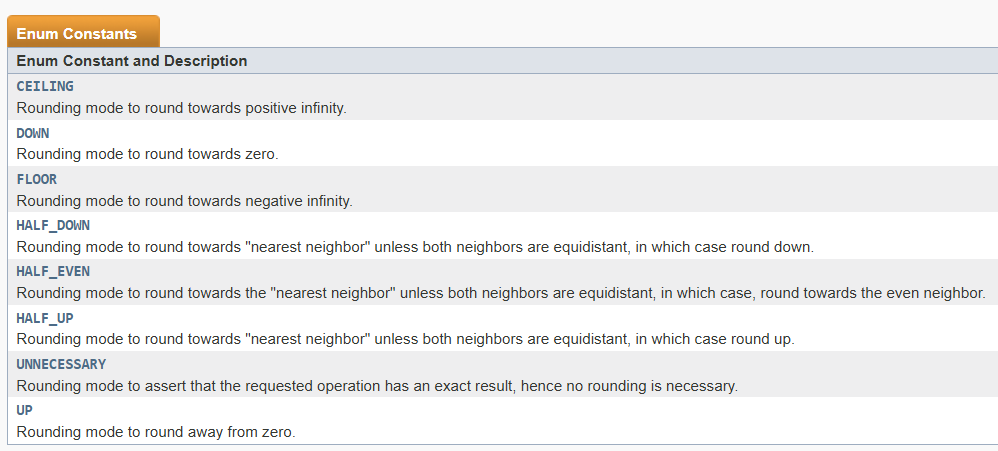

# BACKEND

## `@Transactional`
- HOẶC tất cả các thao tác thành công **(COMMIT)**
- HOẶC nếu xảy ra lỗi phù hợp thì toàn bộ thay đổi sẽ bị hủy **(ROLLBACK)**
- Khi gán với METHOD
    + Nếu method đó bị lỗi mọi hoạt động ở trước đấy sẽ bị ROLLBACK

## BigDecimal
### `divide()`
> `divide(BigDecimal divisor, int scale, RoundingMode roundingMode)`
* Parameters: Hàm này nhận vào 3 tham số:
    + **`divisor`** là số chia
    + **`roundingMode`** cho biết chế độ làm tròn nào sẽ được áp dụng
    + **`scale`** xác định bao nhiêu chữ số thập phân sau dấu phẩy

### Stream
- Được giới thiệu để đơn giản hóa việc xử lý các tập hợp và dữ liệu
- Cho phép xử lý dữ liệu mà không làm thay đổi dữ liệu gốc
- Đồng thời giảm thiểu sử dụng vòng lặp để tính toán

#### Các thao tác trung gian quan trọng
1. **`map()`**: được sử dụng để trả về một luồng chứa kết quả của việc áp dụng hàm đã cho cho các phần tử của luồng này.
2. **`filter()`**: được sử dụng để chọn các phần tử theo vị từ được truyền vào làm đối số.
3. **`sorted()`**: được sử dụng để sắp xếp luồng dữ liệu
